# my3dmaps

Turn real-world topography into multi-colour, 3D-printable landscape tiles
for the **Elegoo Centauri Carbon 2 Combo** (4 filament slots, 256 mm bed).
Pick an area and scale on a map, set the height exaggeration, preview the
coloured model, and export a multi-object 3MF (one object per colour) plus
per-colour STLs and a print plan. With OrcaSlicer's CLI configured it also
produces G-code. This whole thing was built by Claude Fable while I slept. 

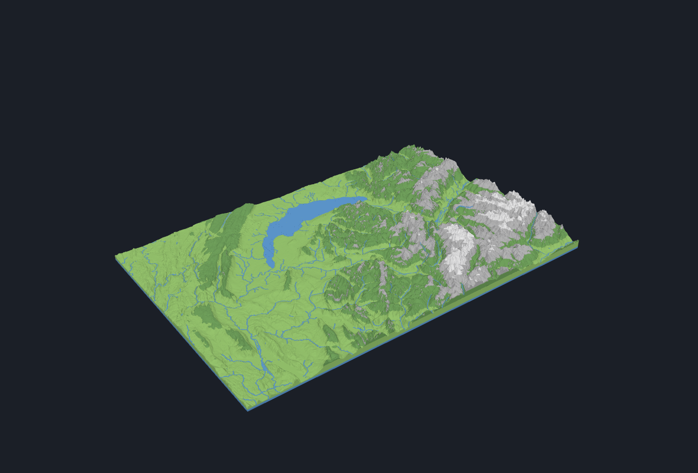

*Lake Geneva to the Mont Blanc massif: 2 × 2 tiles of 245 mm at 1:200,000, sized for a 50 × 50 cm frame, 2× height
exaggeration (about 49 mm tall, so it fits a 6 cm deep frame under glass), five colours (water, two vegetation tiers, rock, snow).*

## What it does

* **Data in:** NASA SRTM 1 arc-second elevation and Natural Earth lakes and
  coastline, both public domain. Rivers, and optionally built-up areas and
  major roads, come from OpenStreetMap (ODbL, credit required, can be
  switched off). See [SOURCES.md](SOURCES.md).
* **Tiles:** 245 × 245 mm modules on a shared grid, so any N × M set butts
  together seamlessly; 2 × 2 fills a 50 × 50 cm frame with a 5 mm border.
  245 mm is the largest square the Centauri Carbon 2 can print: its slicer
  profile has a 10 × 20 mm no-print zone in the front-right corner, and each
  tile is placed on the bed clear of it. Tiles are meant to be glued edge to
  edge; an optional shrinkage compensation keeps the cooled parts at nominal
  size.
* **Colours:** a config-driven, elevation-ordered palette. Bands that do not
  occur in a region are dropped automatically (Liverpool has no rock or snow).
  With more colours than slots the two least distinct bands are merged, or a
  manual mid-print swap is planned at the layer where a finished colour frees
  its slot.
* **Mesh:** every colour is a closed, watertight solid built so that each
  spool is loaded once and prints bottom to top. Flat faces are merged
  losslessly, which halves file sizes.
* **UI and CLI:** a local web app with a Leaflet picker and a live Three.js
  preview, and a headless command line for scripted builds.

## Gallery

### Liverpool and the Mersey, 1:50,000, 2 × 2 tiles

The current `presets/liverpool.json` is the framed print (2026-11-02): 2 × 2
tiles of 175 × 225 mm (350 × 450 mm, portrait) behind a 300 × 400 mm frame
window, at most 10.5 mm tall (3.3×), on the OS National Grid, in four
filaments (slots 1–4: glossy blue, army dark green, army beige, wood brown), with a black
film overlay (`overlay.svg`). The pictures below are from the earlier square
2 × 2 × 245 mm version at 8×. Rock and snow are pruned; the shore band
marks tidal flats. Rivers, canals and brooks are drawn from OpenStreetMap.

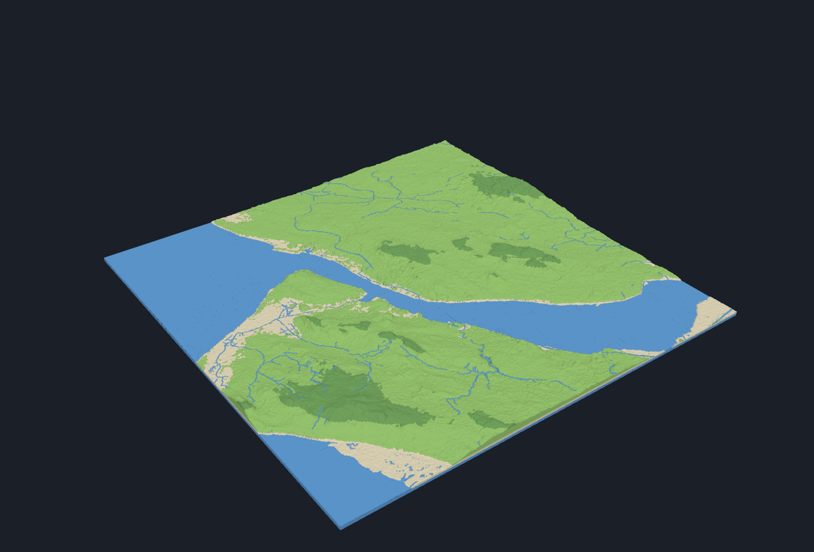

| tile_x0_y1 (north-west) | tile_x1_y1 (north-east) |
|---|---|
| 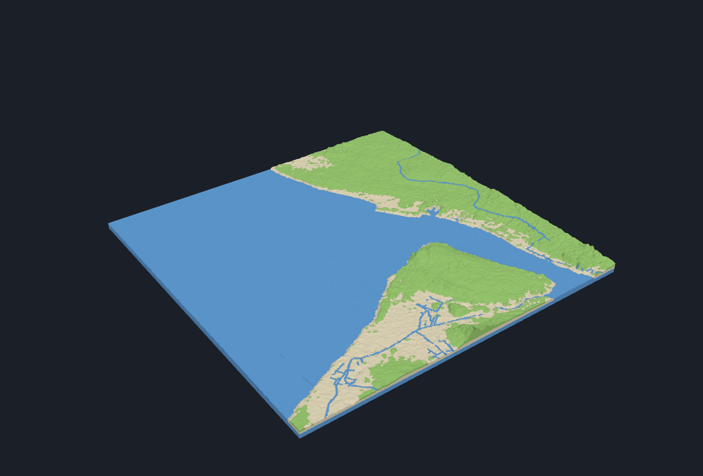 | 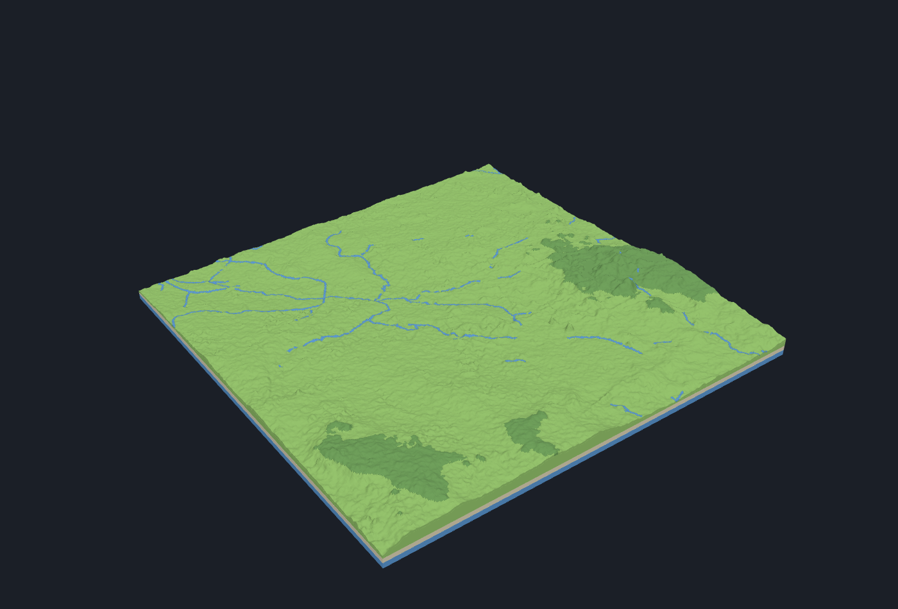 |
| **tile_x0_y0 (south-west)** | **tile_x1_y0 (south-east)** |
| 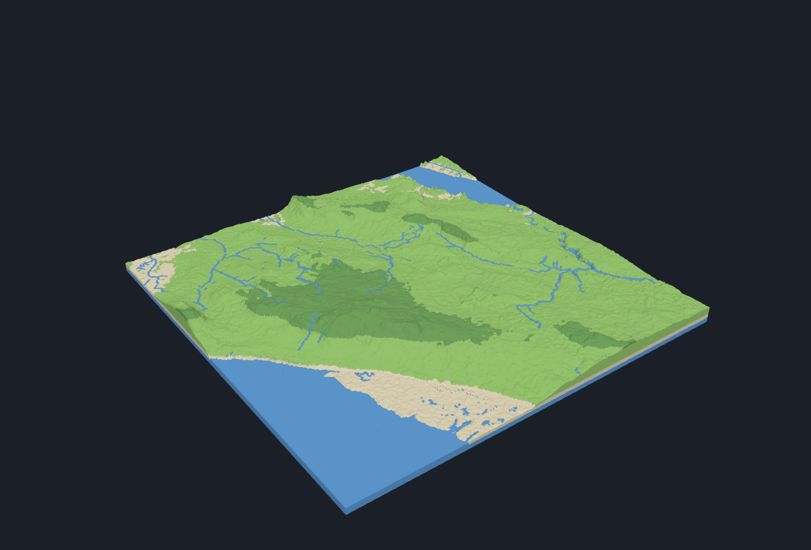 | 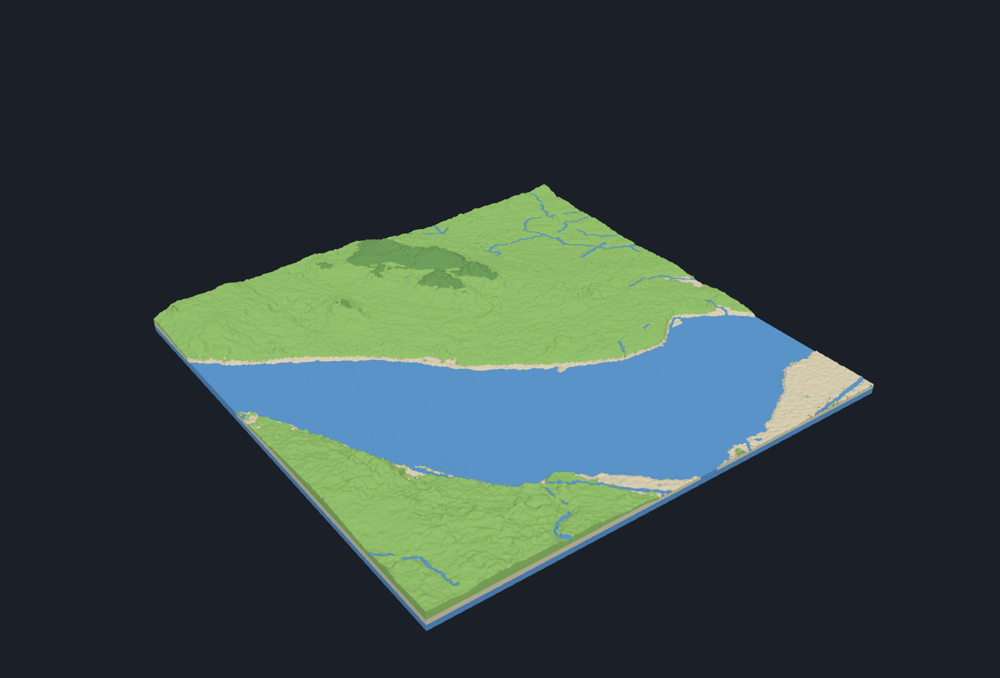 |

The same area with the optional **urban layer** switched on (built-up land
use and motorway/trunk/primary roads in dark grey):

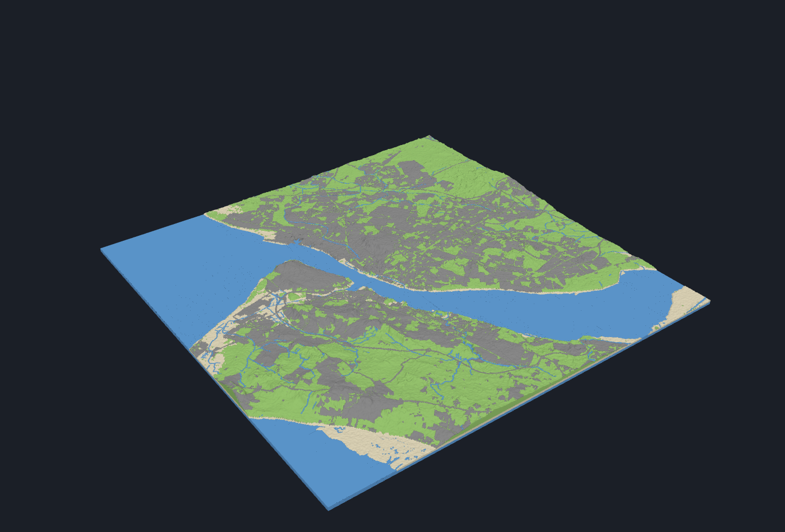

### Geneva to Mont Blanc, 1:200,000, 2 × 2 tiles of 245 mm

Five colours on four slots: the preset uses the manual-swap strategy, so the
two eastern tiles that reach the snowline pause once, at about 27 to 28 mm, where
lowland green has finished and snow starts. The two western tiles need no
manual swap. There is no shore band here: at this scale it is only a 1 to 2 mm
rim around the lake, and dropping it removed most of the manual swaps.
The lake surface is read from SRTM's flattened water and sits at 370 m.

| tile_x0_y1 (north-west, Lake Geneva) | tile_x1_y1 (north-east) |
|---|---|
| 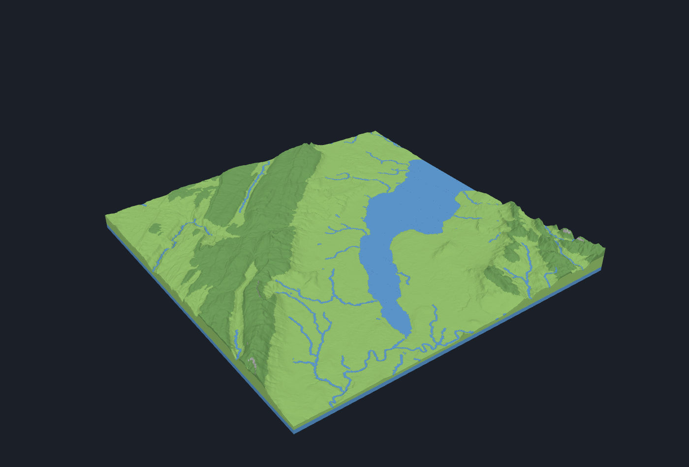 | 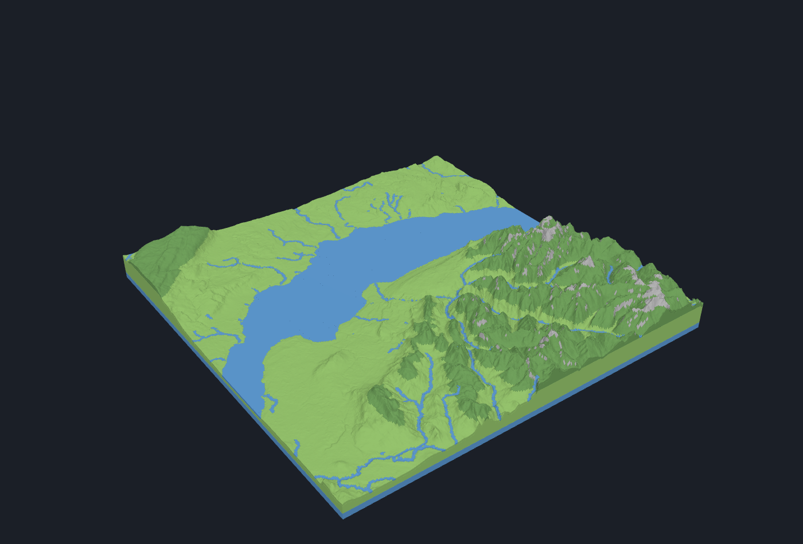 |
| **tile_x0_y0 (south-west)** | **tile_x1_y0 (south-east, Mont Blanc)** |
| 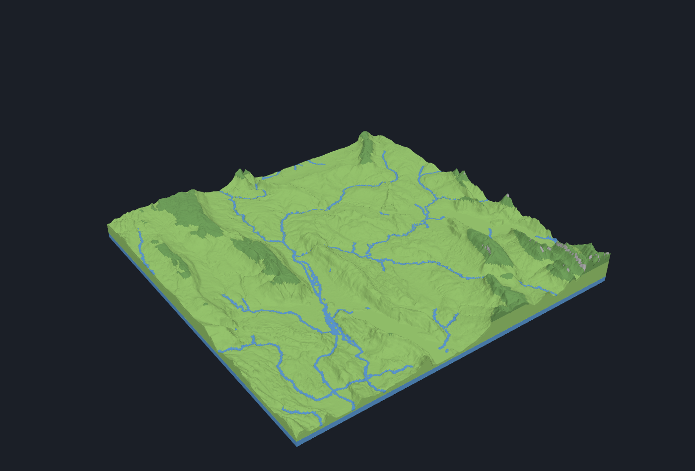 | 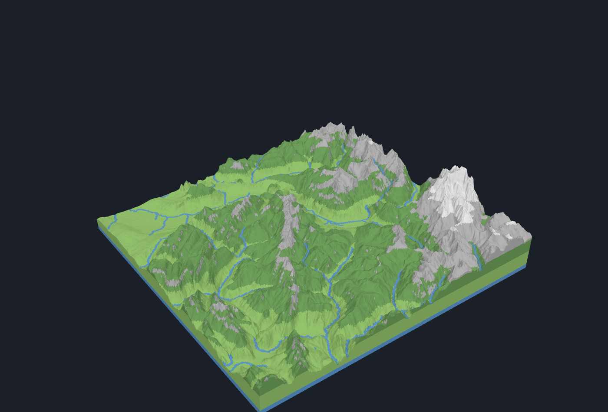 |

### Web UI

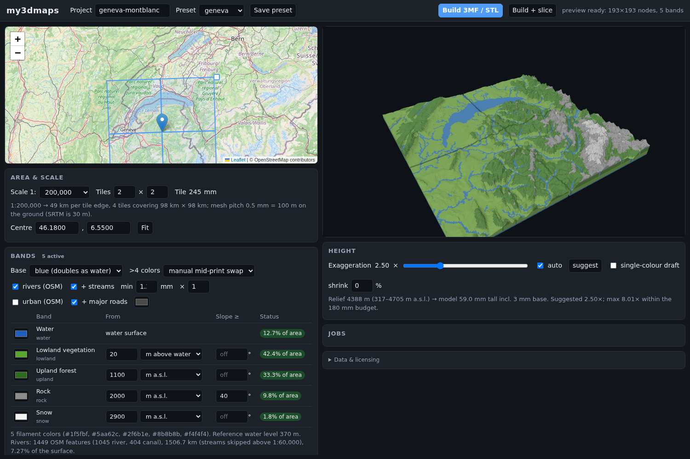

Drag the centre pin, drag the corner handle to change scale, edit band
thresholds and colours, toggle rivers and the urban layer, move the
exaggeration slider (the preview re-scales instantly), then build.

## Install

```bash
uv venv .venv && uv pip install -e ".[dev]"      # or: python -m venv .venv && .venv/bin/pip install -e ".[dev]"
source .venv/bin/activate
```

Pure-Python geospatial stack (numpy, scipy, shapely, pyproj, pyshp), no GDAL.
Python 3.11+. Data is downloaded on first use and cached under
`~/.cache/my3dmaps/` (override with `MY3DMAPS_CACHE`).

## Use

```bash
my3dmaps serve                          # web UI at http://127.0.0.1:8000
my3dmaps info  presets/geneva.json      # fetch data, report bands / relief / suggested exaggeration
my3dmaps build presets/liverpool.json --out out/liverpool        # 3MF + STL per tile, PRINT_PLAN.txt
my3dmaps build presets/geneva.json --out out/geneva --slice      # ... and run OrcaSlicer headlessly
my3dmaps overlay presets/liverpool.json --out out/liverpool      # only the film overlay SVG (+ relief top view)
my3dmaps slicer probe                   # check which CLI flags the installed slicer supports
my3dmaps slicer run out/geneva/tile_x0_y0 --dry-run              # print the slicer command for one tile
```

### Film overlay (`overlay.enabled`)

`overlay.svg` is a black-only sheet the size of the frame window
(`overlay.window_mm`, centred on the model), to print at 100 % on transparent
film and lay on the glass. It holds contours from SRTM (smoothed, every
`contour_m`, labelled index contours), OpenStreetMap place names, railways
(tunnels dashed), motorways, local ferries, stations, stadiums, lighthouses,
named hills and river names, a grid in `overlay.grid_crs` (OS National Grid
by default) numbered in the border with the 100 km square letters, small
triangles where the glued tiles meet (to line the film up with the seams), and
the title, scale bar and data credits along the bottom. Masks keep the film
clear under labels and down the middle of motorways; nothing is printed white.
`overlay_relief_topview.png` is a shaded top view of the relief cropped to the
same window; `python3 tools/compose_overlay.py out/<name>` stacks the two
into `overlay_check.png` (headless Chromium) for checking.

Overrides: `--scale 100000 --tiles 2x2 --exaggeration 2 --pitch 0.4 --shrinkage 0.3 --no-rivers --urban`.
Set `"monochrome": true` in a project (or tick *single-colour draft* in the UI) for a one-filament draft print.

### Output per tile (`out/<name>/tile_x<i>_y<j>/`)

* `tile_x0_y0.3mf`: one object per colour, with OrcaSlicer per-object extruder
  metadata and pause markers for manual swaps.
* `<band>.stl`: the same objects as separate STLs (input for the CLI slicer).
* `plan.json`: slot assignment, Z ranges, manual swap heights.
* `preview.glb`: coloured mesh for any glTF viewer (the renders above are made from these).
* `sliced/`: G-code and slicer log (with `--slice`).

`PRINT_PLAN.txt` at the project root lists slots, swap heights and the data
credits for every tile. The Mont Blanc tile of the Geneva preset:

```
--- tile_x1_y0 (height 48.9 mm) ---
  slot 1: water+base               #1f5fbf  z    0.0 -   22.6 mm
  slot 2: lowland                  #5aa62c  z    3.0 -   14.1 mm
  slot 3: upland                   #2f6b1e  z    8.5 -   21.7 mm
  slot 4: rock                     #8b8b8b  z   12.3 -   31.5 mm
  slot 2: snow                     #f4f4f4  z   27.3 -   48.9 mm
  MANUAL SWAP at z=27.3 mm: slot 2 #5aa62c -> #f4f4f4 (lowland -> snow)
```

## Slicing (OrcaSlicer / Elegoo Slicer)

Export the machine (Elegoo Centauri Carbon 2), process and four filament
presets as JSON from the slicer GUI, then point the project at them:

```json
"slicer": {
  "executable": "/path/to/orca-slicer",
  "machine_preset": "presets/slicer/machine.json",
  "process_preset": "presets/slicer/process.json",
  "filament_presets": ["presets/slicer/pla_blue.json", "presets/slicer/pla_tan.json",
                       "presets/slicer/pla_green.json", "presets/slicer/pla_grey.json"]
}
```

The driver uses `--load-assemble-list` (per-band STLs merged into one
multi-part object, one filament per part), `--load-settings`,
`--load-filaments`, `--slice 0`, `--export-3mf`, `--outputdir`. Manual-swap
pauses are inserted into the G-code at the planned heights using the machine
preset's pause command (fallback `M600`, the CC2 profile's pause command).

**Prime tower.** A 245 mm tile leaves no room on the bed for a prime tower,
so the driver slices with a copy of your process preset that has
`enable_prime_tower` switched off (`slicer.prime_tower`: `auto`, `on` or
`off`; `auto` keeps the tower only when at least 35 mm of bed is free). On
the CC2 this costs little: its profile sets `purge_in_prime_tower = 0`, and
its filament-change command purges each colour change itself, off the model.
What is lost is the nozzle wipe on the tower and OrcaSlicer's "flush into
objects' infill", which hides part of each purge inside the model's infill
but only works while a prime tower is enabled.

**This was written from the
OrcaSlicer sources, not verified against a live install**: run
`my3dmaps slicer probe` first. Without a slicer, `build --slice` still writes
the command it would have run to `sliced/slicer.log`.

## How the model is built

1. A UTM node grid for the whole tile set (shared borders, so tiles are seamless).
2. SRTM is sampled bilinearly onto the grid; voids are filled.
3. Natural Earth lakes and land polygons seed water bodies; each body's level
   is read from the DEM and the mask snaps to SRTM's flat water surfaces.
4. Elevation bands' lower thresholds become horizontal cutting planes; the
   solid under the surface is split into **slabs**, strictly bottom to top, so
   each colour prints in one contiguous Z range.
5. A **skin** (`skin_depth_mm`, 1.2 mm) on top carries the surface colour,
   which is where the non-elevation rules act: slope → rock, distance to water
   → shore, flat water → blue. **Rivers** are painted into this skin as a
   thinner blue layer (`rivers.depth_mm`, 0.6 mm) that follows the terrain,
   widened to at least `rivers.min_width_mm` (1.2 mm, about three lines of a
   0.4 mm nozzle) so even a brook prints. Long rivers are drawn wider, up to
   2.5×, so the main rivers stand out. Green gaps too narrow to print are
   filled and tiny blue fragments dropped. Streams and canals are only
   included at 1:60,000 or larger: at smaller scales canals are mostly
   drainage and irrigation ditches that would print as parallel clutter
   beside the river. The optional **urban** overlay
   (`urban.enabled`, off by default) works the same way in dark grey.
6. Bands with no area are pruned. With more colours than slots, the two least
   distinct adjacent bands merge, or with `overflow: "swap"` a manual filament
   swap is planned where a finished colour's slot frees up. If the urban
   overlay has to go, its cells revert to the terrain underneath.
7. A plain square base plate. Shrinkage is best handled in the slicer: set
   "Shrinkage (XY)" in the OrcaSlicer filament profile (about 99.7 % for PLA)
   so cooled tiles measure exactly 245 mm. my3dmaps can also compensate
   (`shrinkage_pct`), but a 245 mm tile already fills the printable bed, so
   that only works with a slightly smaller tile (e.g. 244.2 mm at 0.3 %).
   Never do both.
8. **Lossless decimation.** Every exactly flat face (slab bottoms, slab tops
   clipped at the next threshold, lake surfaces) is covered by rectangles and
   fanned from a centre vertex, keeping every boundary node its neighbours
   use. Geometry is identical, and files are roughly half the size they
   would otherwise be.
9. Export 3MF, STLs, GLB, plan.

**Mesh resolution.** The default grid is 0.25 mm (`pitch_mm`), finer than
the 0.4 mm nozzle, so slopes print without visible facets and colour edges
don't step. At 1:200,000 SRTM's 30 m samples are 0.15 mm apart, so this is
real relief, not interpolation. A 245 mm tile is 5 to 6 million triangles:
the Mont Blanc tile's 3MF is 67 MB and its STLs 320 MB. Building the four
Geneva tiles takes about 2.5 minutes and 4 GB of memory. Use `--pitch 0.5`
for quick drafts.

## Configuration

A project is one JSON file (see `presets/`). The important fields:

| Field | Meaning |
|---|---|
| `center_lat`, `center_lon`, `scale`, `tiles_x`, `tiles_y` | Where, how big (1:`scale`), how many tiles |
| `tile_mm`, `tile_mm_y` | Tile width and (optional, for rectangular tiles) height on the print |
| `crs`, `center_xy` | Model projection (`utm` = auto zone, or e.g. `EPSG:27700`) and an optional centre in its metres, so grid lines fall on round numbers |
| `exaggeration` | Height multiplier; `null` picks one that gives ~45 mm of relief per tile |
| `base_mm`, `max_height_mm`, `pitch_mm` | Base plate thickness, height budget, mesh pitch on the print |
| `palette.bands[]` | Ordered bands with `color`, `from_m` or `from_water_m`, optional `slope_deg`, `max_distance_m`, `requires_water` |
| `palette.base_color`, `palette.overflow`, `palette.skin_depth_mm` | `blue`/`black`/`none`; `merge` or `swap`; skin thickness |
| `rivers` | `enabled`, `classes`, `stream_max_scale`, `min_width_mm`, `width_scale`, `depth_mm` |
| `urban` | `enabled` (default false), `landuse`, `roads`, `road_min_width_mm`, `color`, `depth_mm` |
| `shrinkage_pct` | XY scale-up for glued tiles (default 0) |
| `slicer` | Executable and exported preset paths |
| `monochrome` | One-filament draft print |
| `palette.bands[].slot`, `.filament` | Pin a band's colour to a physical slot on every tile (and name the filament in the plan) |
| `palette.classify_smooth_m`, `palette.despeckle_mm2` | Smooth the DEM before choosing surface colours; repaint colour islands smaller than this |
| `slicer.prime_tower` | `auto`/`on`/`off`; `on` also places the tile beside a free `prime_tower_room_mm` strip and writes `wipe_tower_x/y` |
| `overlay` | Film overlay: `enabled`, `window_mm`, margins, `grid_crs`, `contour_m`, `places`, `symbols`, `title`, `labels` |

## Data and licensing

| Layer | Source | Licence |
|---|---|---|
| Elevation | NASA/USGS SRTM 1 arc-second v3 | Public domain |
| Lakes, coastline | Natural Earth 1:10m | Public domain |
| Rivers, urban layer | OpenStreetMap via Overpass | ODbL: credit "© OpenStreetMap contributors" on models that include them |

Untick rivers and urban (or `--no-rivers`) for a strictly public-domain
model. Details, citations and rejected alternatives are in
[SOURCES.md](SOURCES.md).

## Development

```bash
pytest              # offline: synthetic terrain, mesh watertightness, rivers, urban, planning, 3MF
pytest --network    # also hits the real SRTM / Natural Earth / Overpass services
python3 tools/render_tiles.py out/liverpool --out docs/images --prefix liverpool   # regenerate the images above
```

The render tool needs `pip install playwright && playwright install chromium`.
Design decisions and the implementation log live in [CLAUDE.md](CLAUDE.md).

## Status

Everything up to the 3MF/STL export is validated on real data for both
presets (closed shells checked independently with trimesh). The headless
slicer driver and the printer's pause command are the remaining pieces to
verify on a machine with OrcaSlicer installed.
